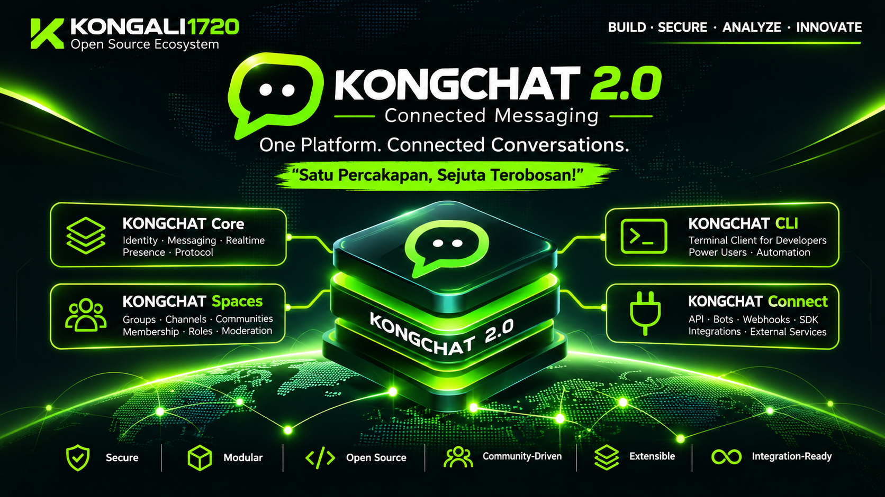

<!-- KONGCHAT-2.0-HEADER-START -->

  

<h1 align="center">KONGCHAT 2.0</h1>

  <strong>One Platform. Connected Conversations.</strong> 
  Satu Percakapan, Sejuta Terobosan!

  
  
  
  
  
  

  <a href="https://github.com/kongali1720/KONGCHAT-2.0">Repository</a> •
  <a href="https://github.com/kongali1720/KONGCHAT-2.0/issues">Issues</a> •
  <a href="https://github.com/kongali1720/KONGCHAT-2.0/discussions">Discussions</a>

<!-- KONGCHAT-2.0-HEADER-END -->

KONGCHAT is an independent open-source messaging platform designed to
bring real-time communication, community spaces, terminal messaging,
and developer integrations into one connected ecosystem.

KONGCHAT 2.0 is a complete product and engineering rebuild.
The legacy implementation is retained separately for reference.
This repository is the foundation for the new platform.

## Product Modules

| Module | Purpose |
|---|---|
| **KONGCHAT Core** | Identity, direct messaging, realtime communication, message persistence, conversation history, and presence |
| **KONGCHAT Spaces** | Groups, channels, communities, roles, membership, and moderation |
| **KONGCHAT CLI** | Terminal-based messaging and developer workflows |
| **KONGCHAT Connect** | APIs, webhooks, bots, integrations, and SDKs |

## Project Principles

- Open development
- Security-conscious engineering
- Privacy by design
- Modular architecture
- Interoperable clients
- Transparent roadmap
- Community-driven contributions
- No unsupported feature claims

## Current Project Status

> **Status: Foundation / Rebuild in progress**

The project is undergoing a comprehensive reconstruction.

The documentation describes the intended architecture and product direction.
Features must not be considered implemented until their code, tests, and
documentation demonstrate that they work.

| Area | Status |
|---|---|
| Product direction | Defined |
| Architecture planning | In progress |
| Backend implementation | Not yet verified |
| Messaging Core | Not yet released |
| Spaces | Planned |
| CLI | Planned for new architecture |
| Connect APIs | Planned |
| Production deployment | Not ready |
| Security review | Pending implementation and review |

## Architecture Direction

KONGCHAT is initially designed as a modular application with clear boundaries.
The project will favor a maintainable deployable system over premature
microservices. Services may be separated as operational needs evolve.

See:
- [Architecture](docs/architecture/ARCHITECTURE.md)
- [Product Vision](docs/product/VISION.md)
- [Features](docs/product/FEATURES.md)
- [Roadmap](docs/roadmap/ROADMAP.md)
- [Security](docs/security/SECURITY-DESIGN.md)

## Development

Development instructions will be maintained as the implementation stack is
selected and the first working environment is committed.

Do not deploy this project as a production messaging service until the
required security, reliability, privacy, and operational controls are
implemented and reviewed.

## Contributing

Contributions are welcome through issues, discussions, pull requests,
documentation, testing, design feedback, and code review.

Start with:
- [Contributing Guide](CONTRIBUTING.md)
- [Code of Conduct](CODE_OF_CONDUCT.md)
- [Security Policy](SECURITY.md)

## Roadmap

The roadmap is maintained in [docs/roadmap/ROADMAP.md](docs/roadmap/ROADMAP.md).
Dates and milestones are targets, not guarantees.

## Community

- GitHub Issues: bug reports and scoped work
- GitHub Discussions: questions, ideas, and community conversations
- Pull Requests: reviewed contributions
- Wiki: product, architecture, development, and contribution documentation

## Sponsorship

Sponsorship may support development, infrastructure, testing, security,
documentation, and community sustainability.

See [Sponsorship](community/SPONSORSHIP.md).

## License

This project is licensed under the MIT License.
See [LICENSE](LICENSE).

---

KONGCHAT 2.0 — One Platform. Connected Conversations.

---

## ☕ Support the Project

If this project has helped your research, learning, or security operations, consider supporting its continued development.

Your support helps sustain development, improve documentation,
maintain existing projects, build new tools, and dedicate more time
to open-source work.

---

### BUILD · SECURE · ANALYZE · INNOVATE

**KONGALI1720 — Open Source Ecosystem**

